# Pohoda

**Weather, clearly.** A calm weather app with today's conditions, hourly detail, a 7-day outlook and a 30-day view. Animated skies follow the real weather, and you can pick the provider, the colours and the icon style.

Live demo: https://pohoda-weather.vercel.app

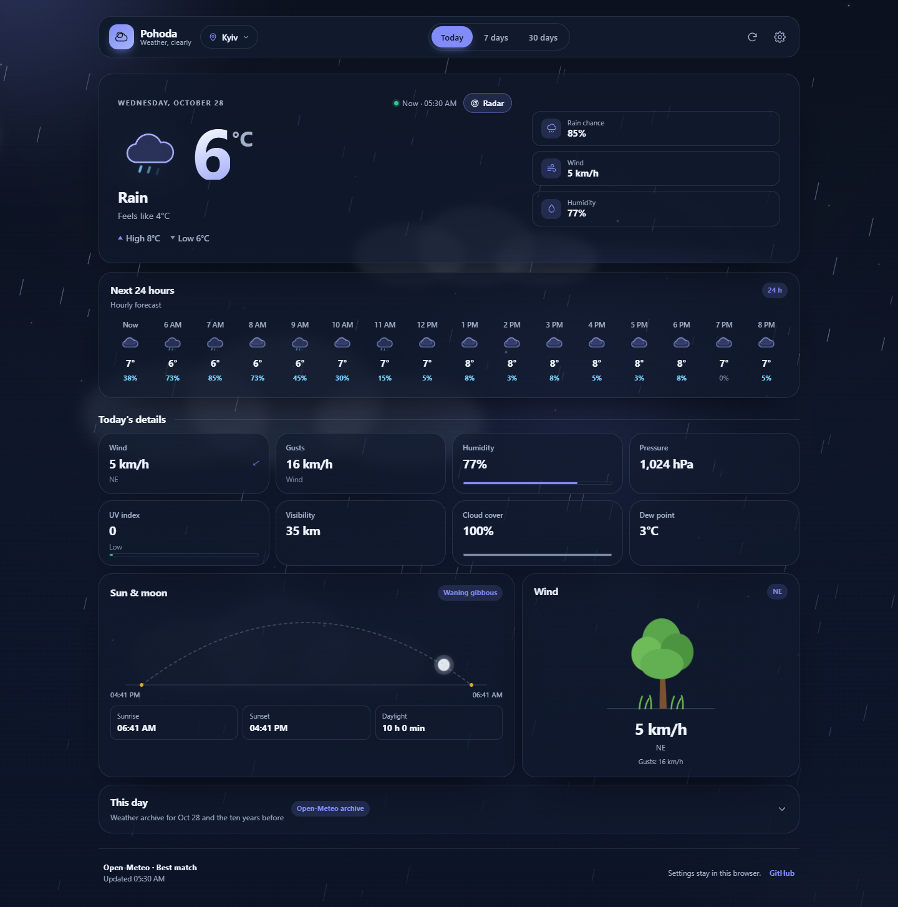

## Why another weather app

- **Readable at a glance.** A large temperature, a short condition line, and the three numbers people actually check: rain chance, wind, humidity.
- **Ranges, not just numbers.** Every day row shows a temperature band placed on the week's scale, so a cold snap or a warm spell is visible without reading a table. Bands follow one colour ramp — violet well below freezing, sky blue at 0 °C, red in the heat — so the week reads as a temperature map.
- **Honest about limits.** Free forecasts stop at 10–16 days. The 30-day tab fills the rest with ten-year climate averages and labels those days as `climate` instead of pretending they are a forecast.
- **Weather you can see.** A full-screen scene (sun, moon, drifting clouds, canvas rain, snow, fog and lightning) reacts to the current condition, and eight icon packs are all animated.
- **Ten years of the same day.** The “This day” block at the bottom compares today with the archive for the same date in each of the last ten years.

## Screenshots

| Today | 7 days |
| --- | --- |
|  | 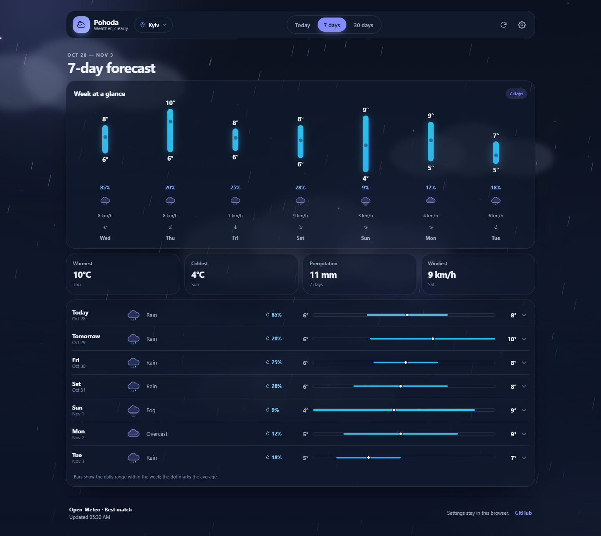 |

| 30 days | Settings |
| --- | --- |
| 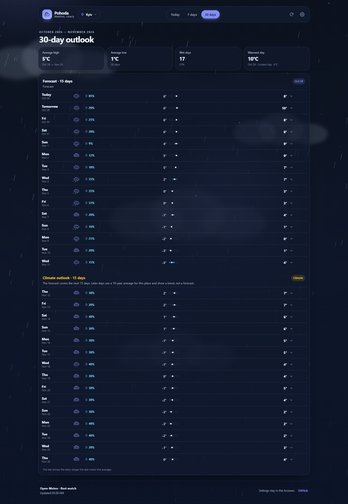 | 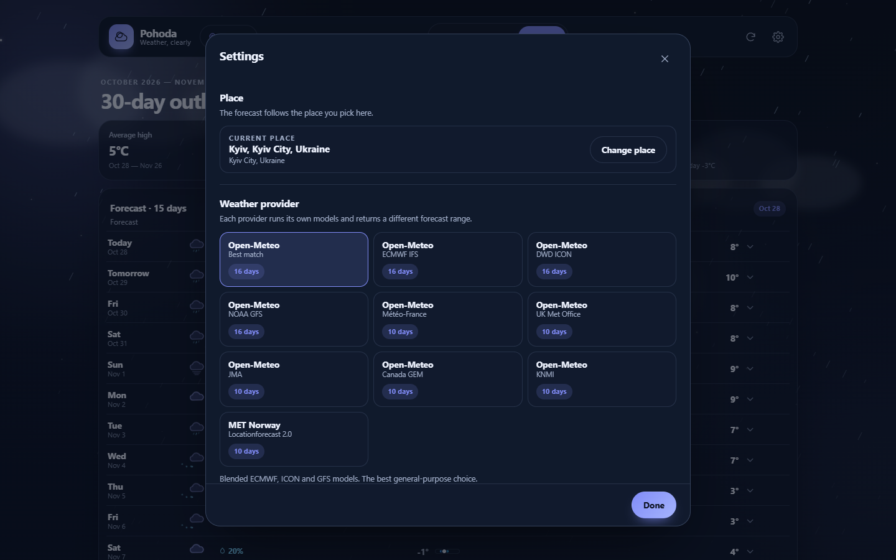 |

| Themes and icon packs | Light theme |
| --- | --- |
| 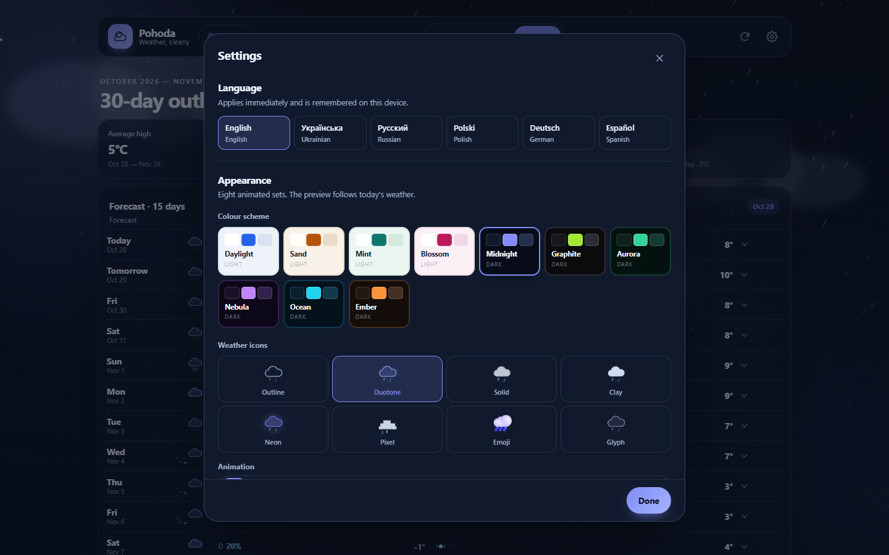 | 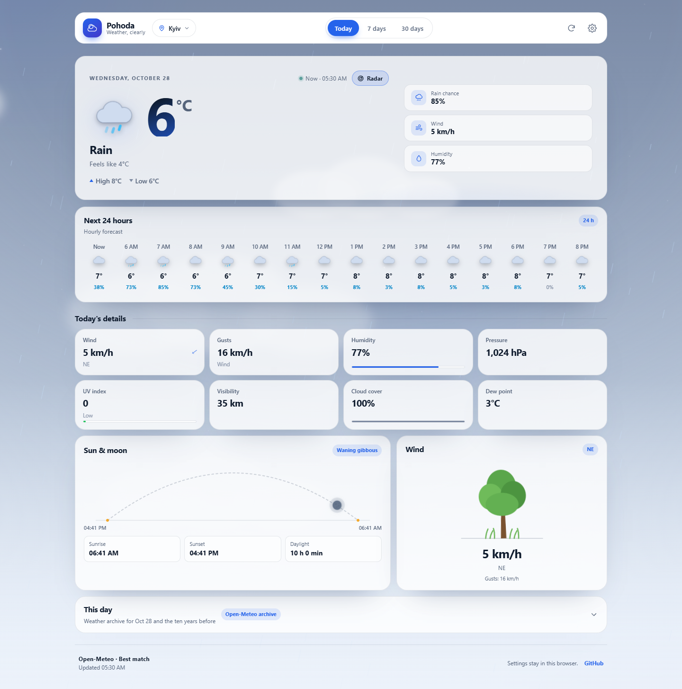 |

| This day — ten years back | Phone — this day |
| --- | --- |
| 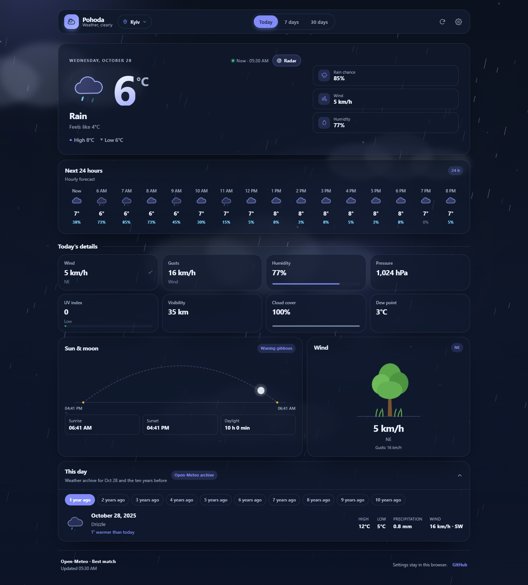 | 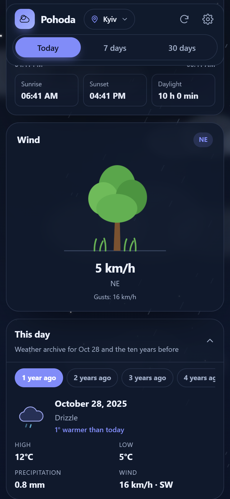 |

| Phone — today | Phone — week |
| --- | --- |
| 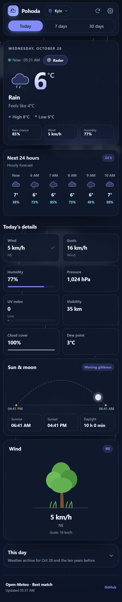 | 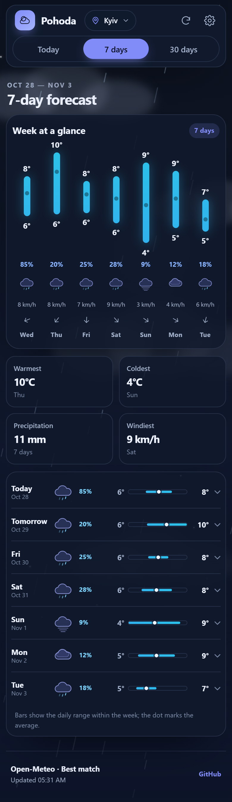 |

| Weather radar | Phone — radar |
| --- | --- |
| 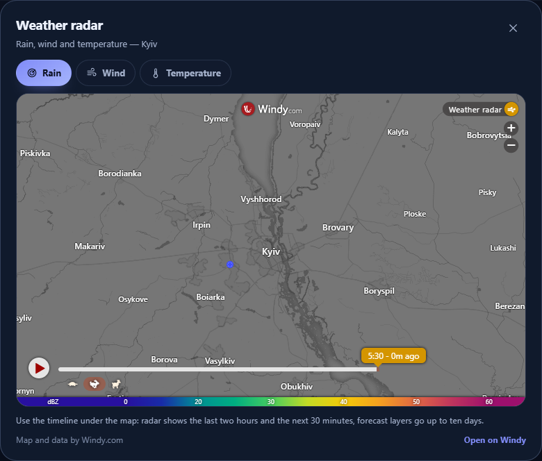 | 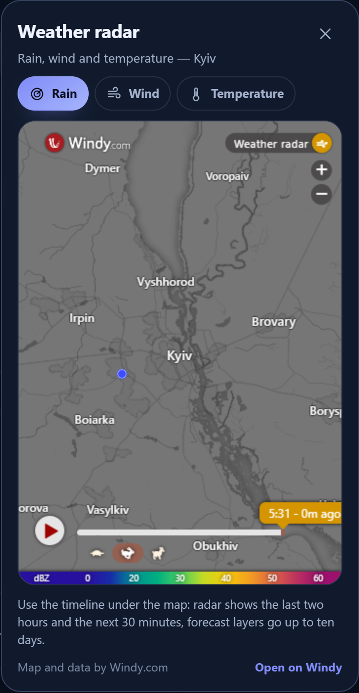 |

## Features

### Forecast

- Current conditions with feels-like temperature, daily high and low.
- 24-hour hourly strip with precipitation probability.
- 7-day view with a chart of vertical temperature ranges (high and low on every bar), rain chance, wind and weekday, plus a summary strip and expandable rows for every day.
- 30-day view split into a real forecast and a clearly marked climate section.
- Sun and moon card: an arc that tracks the sun in real time with a filled trail from sunrise, then switches to the moon after sunset — its current phase (eight names, from new moon to waning crescent), a soft glow and the night path from sunset to the next sunrise. Sunrise, sunset and daylight length stay below.
- Detail cards for wind and gusts, direction, humidity, pressure, UV index, visibility, cloud cover and dew point.
- **“This day” archive block** at the bottom: ten tabs from one to ten years back, each with the weather type, high and low, precipitation, wind and how much warmer or colder that day was compared with today.
- **Weather radar** from the hero card: a Windy map with live rain, wind and temperature layers, switched with one tap. The timeline under the map covers the last two hours and the next 30 minutes for radar, and up to ten days for the forecast layers.

### Providers

Ten free sources, switchable in Settings. Every one of them works without an API key or an account:

| Provider | Model | Horizon | Key |
| --- | --- | --- | --- |
| Open-Meteo | Best match | 16 days | not needed |
| Open-Meteo | ECMWF IFS | 16 days | not needed |
| Open-Meteo | DWD ICON | 16 days | not needed |
| Open-Meteo | NOAA GFS | 16 days | not needed |
| Open-Meteo | Météo-France | 10 days | not needed |
| Open-Meteo | UK Met Office | 10 days | not needed |
| Open-Meteo | JMA | 10 days | not needed |
| Open-Meteo | Canada GEM | 10 days | not needed |
| Open-Meteo | KNMI | 10 days | not needed |
| MET Norway | Locationforecast 2.0 | 10 days | not needed |

Commercial providers that charge for their API were removed on purpose, so there is no key field, no `.env` file and nothing to configure.

### Places

- Search by city or town name in any of the six interface languages, including Cyrillic and diacritics.
- “Use my location” uses the browser Geolocation API and reverse-geocodes the coordinates.
- Recent places are remembered; the first launch guesses a city from the browser time zone, with Kyiv as the fallback.

### Appearance

- **Ten colour schemes:** `daylight`, `sand`, `mint`, `blossom` (light) and `midnight`, `graphite`, `aurora`, `nebula`, `ocean`, `ember` (dark).
- **Eight animated icon packs:** outline, duotone, solid, clay, neon, pixel, emoji, glyph.
- **Full-screen scenes** for clear, partly cloudy, overcast, fog, rain, snow and thunderstorms, with drifting colour fields, moving clouds, canvas particles for precipitation and a lightning flash for storms.
- **A wind card with a tree and grass** that bend further and faster as the wind picks up.
- **Motion levels:** full, calm, off. An explicit choice always wins; the system's reduced-motion preference only sets the default on the first visit.

### Language and units

- Interface: English, Ukrainian, Russian, Polish, German, Spanish. All 6 catalogues are tested for key and placeholder parity.
- Temperature: °C / °F.
- Wind: km/h, m/s, mph.
- Pressure: hPa, mmHg, inHg.
- Precipitation: mm / in.

### Platform

- Responsive from 360 px phones to wide desktops.
- The header stays pinned while the page scrolls.
- Installable PWA with a manifest and maskable icons.
- Theme is applied before first paint, so there is no flash of the wrong colours.
- Settings persist in `localStorage` under `pohoda.prefs.v1`.
- Automatic refresh every 10 minutes and when the tab becomes visible again.

## Tech stack

- Next.js 16 (App Router, Turbopack) and React 19
- TypeScript in strict mode
- Hand-written CSS with custom properties; no UI framework
- Vitest for unit tests of units, code mappings, time zones, formatting, catalogues and metadata

No runtime UI dependencies beyond React.

## Getting started

```bash
npm install
npm run dev
```

Open http://localhost:3000.

```bash
npm run build      # production build
npm run start      # serve the production build
npm run typecheck  # tsc --noEmit
npm test           # 59 unit tests
```

## API

The app talks to four internal routes so rate limits and caching stay on the server:

| Route | Purpose |
| --- | --- |
| `GET /api/weather` | Normalised snapshot: current, hourly and daily points, plus climate-filled days |
| `GET /api/history` | The same calendar day for each of the last ten years, from the Open-Meteo archive |
| `GET /api/places` | Multilingual place search via Open-Meteo geocoding |
| `GET /api/places/reverse` | Coordinates to a place name |

All responses are normalised to one `WeatherSnapshot` shape, so the UI does not know which provider produced the data.

## How the 30-day view works

1. The selected provider returns its maximum horizon (5–16 days).
2. For the remaining days, the app asks the Open-Meteo archive for the same calendar days in 2015–2024 and averages them.
3. Those days carry `source: "climate"`, a hatched range bar, a `Climate` badge and a note explaining that they are a trend, not a forecast.

Archive responses are cached for 24 hours.

## How the “This day” block works

1. The card asks `/api/history` for the current place and today's date.
2. The route fires ten single-day requests to the Open-Meteo archive API in parallel, one per year, and keeps only the days that came back complete.
3. The client renders them as tabs — `1 year ago` … `10 years ago`, pluralised per locale — with the weather icon, high, low, precipitation, wind and the temperature difference against today.
4. Results are cached at the edge for 24 hours, because a day in the past never changes.

## Project structure

```
app/
  api/weather/         provider dispatch and normalisation
  api/history/         ten-year archive for one calendar day
  api/places/          search and reverse geocoding
  layout.tsx           metadata, theme boot script, fonts
  page.tsx             app entry
components/
  AppShell.tsx         layout, tabs, dialogs, loading and error states
  WeatherScene.tsx     full-screen animated scene + canvas particles
  WeatherIcon.tsx      eight animated icon packs
  views/               Today, Week, Month
  DayRow, SunCard, RangeBar, ThisDayCard, RadarDialog, Modal, SettingsDialog, PlaceDialog, Toast
lib/
  weather/             providers, normalisation, code maps, climate, sun
  history.ts           Open-Meteo archive loader for the “This day” block
  i18n/                six catalogues and typed message keys
  client/              settings store, weather hook
  theme, units, time, format, places, types
tests/                 unit tests (Vitest)
docs/                  screenshots
```

## Deploy

The project is a standard Next.js app and deploys to Vercel without configuration:

```bash
npx vercel --prod
```

No API keys, database, cron job or external storage are required.

## Credits

Weather data by [Open-Meteo](https://open-meteo.com/) (including the ECMWF, DWD, NOAA, Météo-France, UK Met Office, JMA, GEM and KNMI model runs) and [MET Norway](https://www.met.no/). Place search by Open-Meteo geocoding, which uses GeoNames data. The radar dialog embeds [Windy.com](https://www.windy.com/) — map and radar data belong to Windy.

## License

MIT — see [LICENSE](LICENSE).
